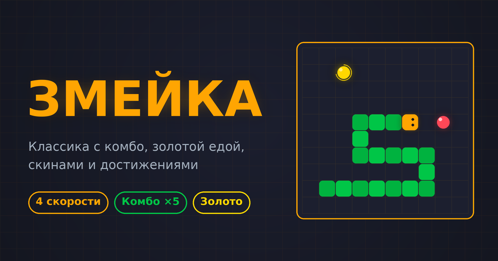

# 🐍 Змейка

Одна страница для десктопа и телефона: на ПК управление с клавиатуры или геймпада, на сенсорных экранах — свайпы и кнопки.

4 уровня скорости от «Лёгкого» до «Хардкора», комбо, золотая еда, скины, достижения и рекорды.

---

## Ссылка

👉 **[https://ky4ka-boroxla.github.io/zmeika/](https://ky4ka-boroxla.github.io/zmeika/)**

---

## Управление

| Устройство | Управление |
|------------|------------|
| Клавиатура | `⬆ ⬇ ⬅ ➡` или `WASD` (в любой раскладке), `Пробел` / `Esc` — пауза |
| Телефон | свайп по полю или кнопки на экране |
| Геймпад | крестовина или левый стик, Start — пауза |

Партия начинается после первого нажатия направления.

---

## Книга предметов

В меню есть иллюстрированная книга: яблоки, комбо, ускорение, режим «сквозь стены» и скины. Листается стрелками, свайпом, кликом по краю страницы или точками внизу. На телефоне открывается по одной странице.

## Музыка

Треки по 80 МБ в репозиторий не нужны. В плеере можно добавить свои файлы или целую папку (`＋ Файлы` / `📁 Папка`) либо перетащить их на карточку плеера. Они сохраняются в браузере и никуда не загружаются. Файлы из папки `music/` (список в `music/list.json`) тоже поддерживаются, отсутствующие файлы пропускаются автоматически.

---

## Расширение для Chrome

Игра работает как расширение: по клику на иконку открывается окно с игрой 560×600.

1. Открой `chrome://extensions` и включи «Режим разработчика».
2. Нажми «Загрузить распакованное расширение» и выбери папку с игрой.
3. Закрепи иконку 🐍 на панели, чтобы открывать игру в один клик.

Кнопка `↗` в углу открывает игру во вкладке. Добавлять свои треки в плеере тоже нужно оттуда: выбор файлов закрывает всплывающее окно. Музыка играет, пока окно открыто.
